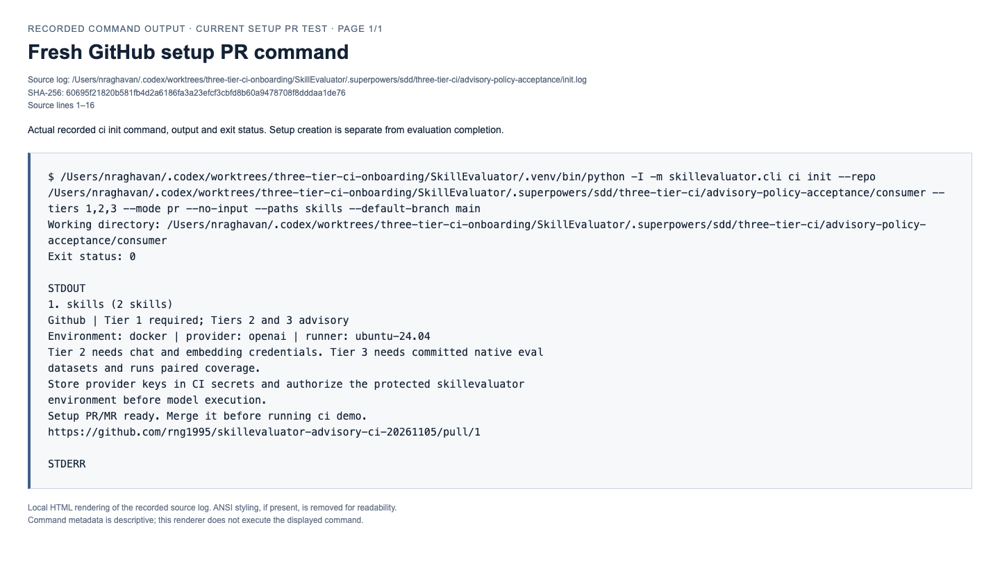
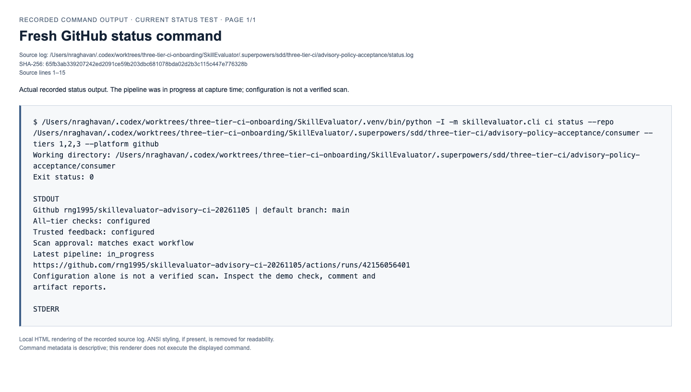
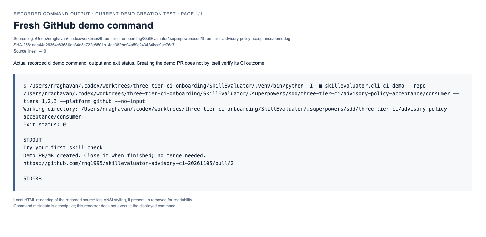
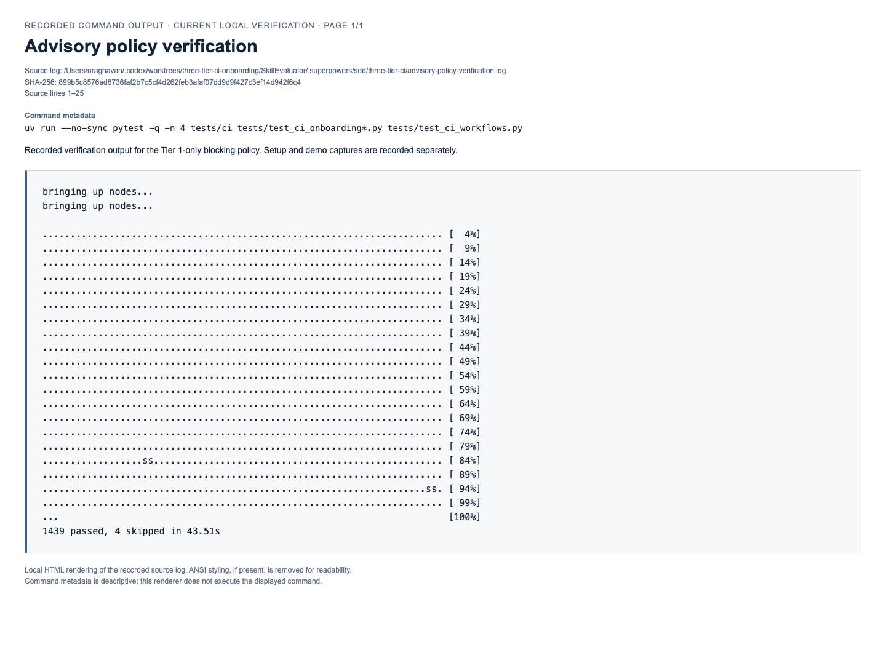

# Tier 1-only CI gate: command output and acceptance

Candidate workflow/runtime/publisher source: `26930710dc8e13dd2f789ad0cf045525ac8d13a5`.
Product PR: https://github.com/NVIDIA/SkillEvaluator/pull/349

## Live acceptance

- [Fresh setup PR #1](https://github.com/rng1995/skillevaluator-advisory-ci-20261105/pull/1): exactly two generated workflow files, inspected before merging in this disposable repository.
- [Setup CI](https://github.com/rng1995/skillevaluator-advisory-ci-20261105/actions/runs/42155808057): passed.
- [Demo PR #2](https://github.com/rng1995/skillevaluator-advisory-ci-20261105/pull/2): only a two-line skill comment, left open.
- [Demo CI](https://github.com/rng1995/skillevaluator-advisory-ci-20261105/actions/runs/42156102845): all five jobs passed.
- [Trusted bot comment](https://github.com/rng1995/skillevaluator-advisory-ci-20261105/pull/2#issuecomment-6676015102): one comment, bound to `61d5bd99ad971994a46b2fc1e5f5e3faca974e38`.
- [Authenticated report archive](https://github.com/rng1995/skillevaluator-advisory-ci-20261105/actions/runs/42156102845/artifacts/13474576606): downloaded and independently validated using the candidate trusted-feedback reader; SHA-256 `f18ccc26540a966589fd315aec5e22547a00576ed250c295fc92742ae90294b0`.
- [Trusted publisher](https://github.com/rng1995/skillevaluator-advisory-ci-20261105/actions/runs/42156358877): passed.

| Tier | Execution outcome | CI gate |
| --- | --- | --- |
| 1 | passed | Required |
| 2 | incomplete: provider credentials absent | Advisory |
| 3 | incomplete: provider credentials absent | Advisory |

The aggregate required gate passed. This no-credential acceptance checks onboarding and advisory reporting; it does not claim completed Tier 2/3 model evaluations. Repository and protected-environment provider credentials were empty. No model calls were made. Local CI/onboarding verification recorded 1,439 passed and 4 skipped. Standalone validation and benchmark publication policies are unchanged.

## Command logs and screenshots

All three onboarding commands ran locally against the candidate installation and exited 0. These screenshots show local HTML renderings of exact recorded command output. Raw logs retain the invocation, working directory, exit status, stdout and stderr. The status command was captured while a pipeline was in progress, and says that configuration is not a verified scan. Creating a setup/demo PR is separate from its CI result, which is linked above.

| Command | Raw output | Screenshot |
| --- | --- | --- |
| `ci init` | [init.log](logs/init.log) | [Setup command](screenshots/fresh-github-ci-init-01.png) |
| `ci status` | [status.log](logs/status.log) | [Status command](screenshots/fresh-github-ci-status-01.png) |
| `ci demo` | [demo.log](logs/demo.log) | [Demo command](screenshots/fresh-github-ci-demo-01.png) |
| CI/onboarding tests | [policy-tests.log](logs/policy-tests.log) | [Test results](screenshots/advisory-policy-verification-01.png) |

This evidence lives on a separate branch; the setup PR adds only the two workflow files.

### ci init

### ci status

### ci demo

### Policy tests

